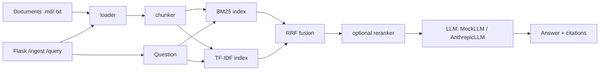

# rag-knowledge-agent

Retrieval-augmented question answering over a document collection, built from scratch (no vector DB, no LLM framework): chunking, BM25 and TF-IDF retrieval, rank fusion, citations, an evaluation harness and a small Flask API. It runs fully offline by default.

## Problem

A plain LLM answers from memory and can invent facts. A RAG system first retrieves relevant passages from a trusted corpus and answers *only* from them, with citations so every claim can be checked. This project implements that loop end to end and measures retrieval quality instead of just eyeballing demos. The bundled corpus is 8 short system-design notes (Raft, CAP, rate limiting, caching, ...).

## Features

- **Chunking**: recursive, overlap-aware splitter (paragraph, line, sentence, word) that tracks character offsets and the nearest Markdown heading as the chunk's `section`.
- **Hybrid retrieval**: BM25 (k1=1.5, b=0.75) and sublinear TF-IDF cosine (numpy), fused with Reciprocal Rank Fusion (k=60). Each retriever is also usable alone (`mode=bm25|tfidf|hybrid`).
- **Optional re-ranker**: `LexicalOverlapReranker` (unigram/bigram coverage plus first-stage rank prior); a pluggable `Reranker` interface for a cross-encoder.
- **Citations**: every answer carries numbered citations (source doc, chunk id, section, score, snippet); `[n]` markers in the text map to them.
- **Generation**: `MockLLM`, a deterministic extractive generator that quotes the best-matching context sentences, or says "I don't know" when nothing matches. `AnthropicLLM` is an optional backend that imports the `anthropic` package lazily; it needs an API key and network, and is **not exercised in tests or in the results below**.
- **Evaluation**: recall@1/3/5, MRR and doc-level recall against a hand-written Q/A set, plus a chunk-size sweep.
- **Flask API**: `POST /ingest`, `POST /query`, `GET /health`, with pydantic request validation.

## Architecture



| Component | File | Role |
|---|---|---|
| Loader | `loader.py` | Reads documents from a directory |
| Chunker | `chunker.py` | Overlapping chunks with offsets and section titles |
| Tokenizer | `tokenizer.py` | Lowercase, stopword removal, light stemmer |
| Retrievers | `retrievers.py` | `BM25Retriever`, `TfidfRetriever` |
| Hybrid | `hybrid.py` | Reciprocal Rank Fusion |
| Reranker | `rerank.py` | No-op and lexical-overlap re-rankers |
| LLM | `llm.py` | `MockLLM`, `AnthropicLLM`, prompt builder |
| Pipeline | `pipeline.py` | Ingest, retrieve, rerank, generate, cite |
| Evaluation | `evaluation.py` | recall@k, MRR |
| API / CLI | `api.py`, `cli.py` | Flask app; `ask`, `eval`, `serve` commands |

## Design decisions and trade-offs

- **Hand-written retrievers over a library**: shows the scoring math and keeps dependencies to numpy. Trade-off: the dense TF-IDF matrix is fine for thousands of chunks, not millions.
- **RRF instead of score blending**: BM25 scores and cosine similarities are on different scales; RRF uses ranks only and needs no tuning.
- **Extractive mock LLM by default**: deterministic, offline, testable, cannot hallucinate. Trade-off: it quotes rather than synthesises, so answers can be stilted (see the demo output).
- **Chunk relevance defined by gold phrases**: a chunk counts as relevant if it comes from the gold document and contains a gold phrase. Cheap and reproducible, but brittle to paraphrase and makes small chunk sizes look worse when a phrase is split across a boundary.
- **Rebuild-all indexing**: `ingest` re-chunks and re-indexes everything. Simple and correct; not incremental.
- **API never accepts server paths**: `/ingest` takes inline documents or `sample_corpus: true` only.

## How to run

```bash
pip install -r requirements.txt          # numpy, flask, pydantic, pytest
export PYTHONPATH=src
python -m pytest -q                      # tests
python scripts/run_eval.py               # retrieval evaluation
python scripts/demo.py                   # sample Q&A with citations
python -m rag_agent ask "What is a cache stampede?" --rerank
python -m rag_agent serve --port 5000    # Flask API
```

```bash
curl -X POST localhost:5000/ingest -H 'Content-Type: application/json' -d '{"sample_corpus": true}'
curl -X POST localhost:5000/query  -H 'Content-Type: application/json' \
     -d '{"question": "Why add jitter to retries?", "k": 3, "mode": "hybrid"}'
```

Optional LLM backend: `pip install anthropic`, set `ANTHROPIC_API_KEY`, then `--llm anthropic`.

## Results (real output)

Tests: `56 passed in 0.29s`.

`python scripts/run_eval.py` (30 hand-written questions over 8 documents / 32 chunks; chunk_size=500, overlap=80):

```
config                recall@1      recall@3      recall@5           mrr  doc_recall@5
bm25                     0.833         0.967         1.000         0.908         1.000
tfidf                    0.833         0.967         1.000         0.908         1.000
hybrid                   0.833         0.967         1.000         0.908         1.000
hybrid+rerank            0.833         0.967         1.000         0.908         1.000

Hybrid retrieval vs chunk size:
config                recall@1      recall@3      recall@5           mrr  doc_recall@5
size=150 (95ch)          0.500         0.800         0.900         0.657         1.000
size=250 (58ch)          0.733         0.967         1.000         0.853         1.000
size=500 (32ch)          0.833         0.967         1.000         0.908         1.000
size=800 (17ch)          0.867         1.000         1.000         0.933         1.000
```

Honest reading: on this small set all four configurations **tie**, so these numbers do not show that hybrid fusion or re-ranking helps; the corpus is too small and the questions too lexically easy to separate them. The chunk-size sweep is the only visible effect, and part of it is the metric penalising phrases split across small chunks. Larger chunks score higher here partly because there are fewer distractor chunks in a 1,659-word corpus.

Demo excerpt (`scripts/demo.py`, hybrid + rerank):

```
Q: How many failures can a five-server Raft cluster tolerate?
A: A cluster of five servers tolerates two failures, because three servers still form a majority. [1] It keeps a replicated log consistent across a cluster of servers so that they behave like a single fault-tolerant state machine. [2]
   [1] raft_consensus :: raft_consensus#2  section='Log replication'  score=0.6071

Q: How do I bake sourdough bread?
A: I don't know based on the provided context.
```

## Limitations

- The corpus (8 documents, ~1,660 words) and the eval set (30 questions) are small and hand-written by the author; the metrics are indicative, not a benchmark, and the ties above mean retrievers are not differentiated.
- Lexical retrieval only: no dense embeddings, so synonym/paraphrase queries will miss.
- `MockLLM` is extractive; second-sentence selection can add loosely relevant text (see the Raft example). Answer quality was not evaluated, only retrieval.
- `AnthropicLLM` has not been run or tested.
- In-memory state, full re-index on ingest, no auth or persistence in the API.
